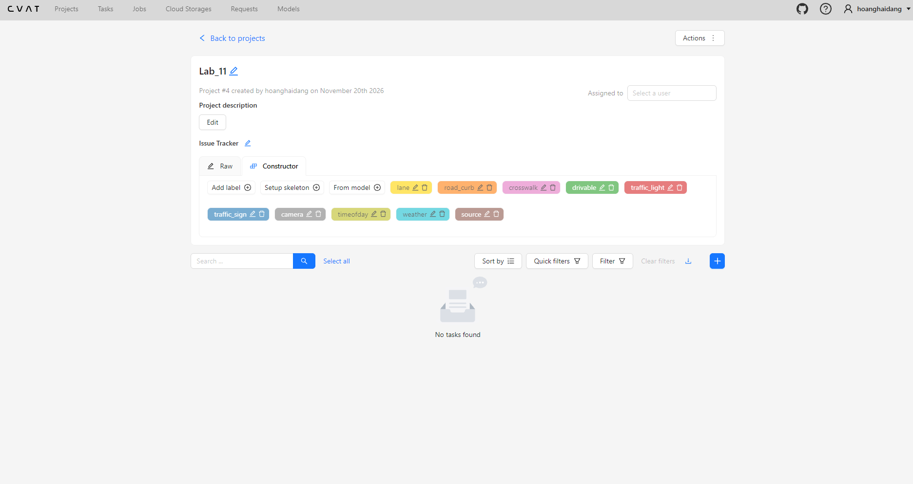
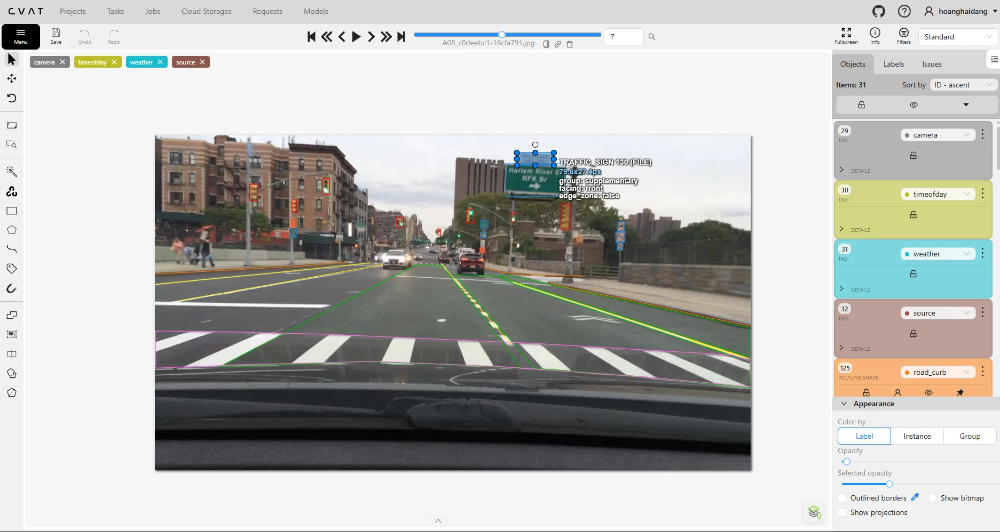
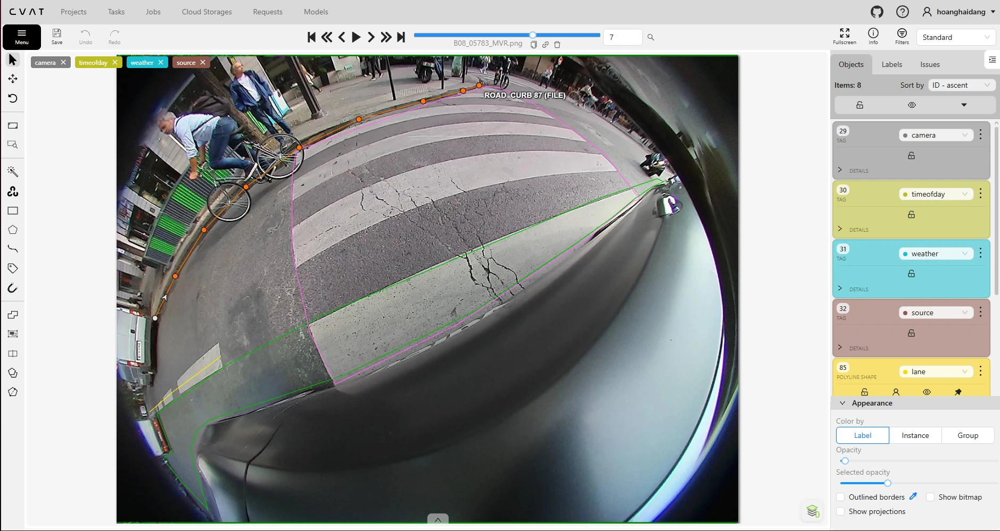

# Báo cáo cá nhân — Ngày 11
Họ tên: Hoàng Hải Đăng               Mã học viên: 2A202603189  
Phiên bản CVAT : 2.74.1  
Guideline: Road v1.0    Lần nộp (`revision` trong manifest): 1  
Thời điểm export: front 20/11/2026 18:55, fisheye 20/11/2026 19:20    Số lần nộp lại sau Rework: 0  

## 1. Kiểm project
| Mục | Đúng như guideline Road v1.0? | Ghi chú |
| --- | --- | --- |
| 6 label, đúng kiểu | Có | So bằng JSON của `road_lab.taxonomy` ở tab Raw |
| Thuộc tính và giá trị | Có | Khớp `configs/road_v1_labels.json` |
| 4 tag ảnh | Có | Mỗi tag là label kiểu Tag, thuộc tính select `value` |

Cách kết thúc polyline: phím **N**.  
Cách đặt tag ảnh: công cụ **Tag** → chọn label → sửa `value` trong Details (CVAT tự điền giá trị đầu danh sách).  
Ghi chú: gom thành 2 task (front 16 ảnh, fisheye 12 ảnh); ảnh thêm giữ tên slot nên checker vẫn nhận ra.

## 2. Số lượng đã gán
| Task | Ảnh | lane | road_curb | crosswalk | drivable | traffic_light | traffic_sign |
| --- | ---: | ---: | ---: | ---: | ---: | ---: | ---: |
| front | 12 | 34 | 13 | 4 | 24 | 27 | 30 |
| front-extra (đã làm 4 / 4) | 4 | 11 | 1 | 2 | 8 | 9 | 16 |
| fisheye | 8 | 5 | 16 | 7 | 7 | 4 | 1 |
| fisheye-extra (đã làm 4 / 4) | 4 | 1 | 2 | 4 | 1 | 2 | 0 |

## 3. Bảng ca khó
| Ảnh | Nhãn | Phân vân giữa | Đã chọn | Lý do |
| --- | --- | --- | --- | --- |
| A04, A09, A11, A14 | lane vạch đôi | 1 hay 2 polyline | 2 polyline, cùng `position`, `kind = double` | Quy ước của lớp |
| A03 | L1 vàng | `double` / `single` | `single` | Hai vạch cách nhau bởi dải gạch chéo |
| A05, A06, A07, A09, A14 | L1 / R1 | Vẽ / không vẽ | Không vẽ | Không thấy vạch; nhờ coach xác nhận miễn QC1-02 |
| A08 | L1 | L1 / vạch ngoài hơn | L1 | Không thấy vạch nào gần làn mình hơn |
| A06 | đèn đi bộ | `green` / `unknown` | `green` | Đang sáng tín hiệu "đi" |
| A14 | L1 | `white` / `yellow` | `yellow` | Ảnh đêm, pixel vạch có sắc vàng |
| A04, A08 | weather | `clear` / `overcast` | `clear` | Nhiều mây nhưng sáng, đường khô |
| B11 | lane | Gán / không gán | Không gán | Chỉ có vạch ô đỗ — bẫy QC1-03 |

## 4. Phiếu QC 1 nhận được
Bạn kiểm lô của tôi: __________  Quyết định nhận được: __________  
| Mã lỗi | Số lỗi | Đồng ý? | Đã sửa? |
| --- | ---: | --- | --- |
|  |  |  |  |

Trước đó đã tự QC 6 ảnh và sửa: sai `position` A04 (QC1-03), ~50 polyline vẽ ngược chiều (QC1-04), thiếu đèn/biển ở A03, A04 (QC1-08, QC1-10), sai `facing`/`group` (QC1-09), `edge_zone` B02 (QC1-11), tag camera B09 (QC1-01).

## 5. Kiểm file export
| File | Mở lại được? | Số shape ảnh 1 (job / file) | Số shape ảnh 2 (job / file) | Tag camera có trong XML? |
| --- | --- | --- | --- | --- |
| `hoanghaidang-front.zip` | Có | A01: 9 / 9 | A08: 27 / 27 | Có (16 / 16) |
| `hoanghaidang-fisheye.zip` | Có | B08: 4 / 4 | B02: __ / 8 | Có (12 / 12) |

CVAT for images 1.1, không kèm ảnh, sha256 khớp manifest.

## 6. Ảnh chụp màn hình
1. Tab Labels của project.

   

2. Ảnh front đã gán đủ (A08).

   

3. Ảnh fisheye, polyline cong (B08 road_curb).

   

4. Đoạn XML có `<polyline label="lane">` (A01):

```xml
<polyline label="lane" source="manual" occluded="0" points="106.59,719.53;282.06,571.51;360.30,507.70" z_order="0">
  <attribute name="position">L1</attribute>
  <attribute name="style">dashed</attribute>
  <attribute name="color">white</attribute>
  <attribute name="kind">single</attribute>
</polyline>
```

## 7. Tự đánh giá
Lỗi mắc nhiều nhất: **QC1-04 — vẽ polyline từ xa về gần**. Ở Ngày 20 sẽ luôn bắt đầu click ở đáy ảnh và chạy `lint` sau 2–3 ảnh đầu.

Nhãn đi vào model: polyline lane thành đích row-anchor, `position` cho biết biên làn đang đi. Lỗi đã sửa ở A04 (vạch mép làn xe đạp ghi `R1` thay vì `R2`) sẽ làm model học sai biên phải của làn, hệ giữ làn (LKA) tính sai tâm làn và lái lệch sang phải.

## 8. (Tùy chọn, buffer) Từ polyline đến đích row-anchor
Ảnh A01, vạch R1:

| y | 720 | 680 | 640 | 600 | 560 |
| --- | ---: | ---: | ---: | ---: | ---: |
| x của chúng tôi | không có làn | 647.9 | 593.1 | 538.2 | 484.3 |
| x của bạn kia | không có làn | không có làn | 601.2 | 544.0 | 486.9 |

1. Dừng sớm 40 px ở đầu xa (y≈547): không hàng nào đổi. Nếu điểm đầu gần xe bắt đầu muộn 40 px thì hàng 680 thành "không có làn" (như bản của bạn kia).
2. Hàng 720 cả hai không có làn; hàng 640 lệch 8.1 px, hàng 560 lệch 2.6 px. Lệch ở hàng gần xe ảnh hưởng LKA nhiều hơn.
3. Năm số x không đổi vì `rowanchor` nội suy theo y. Gặp khó là các script dựa vào thứ tự điểm: kiểm chiều vẽ của `road_check` (QC1-04) và code coi điểm đầu là điểm gần xe.
